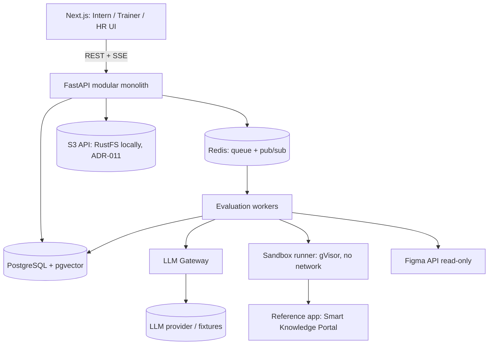

# Design Document

## Overview

AITMS is built as a modular monolith (FastAPI) with a Next.js frontend, plus two separated runtimes: evaluation workers and a sandbox runner. One evaluation engine serves four role profiles through configuration and plugins.

The full detail lives in the source documents. This design records the decisions that drive implementation and maps them to requirements.

- #[[file:docs/AITMS – Architecture Specification.md]]
- #[[file:docs/AITMS – UI Design Brief and Reference Board (1).md]]
- #[[file:docs/aitms-tokens.css]]

### Guiding principles

1. One engine, many role profiles. Roles are configuration, not code forks.
2. Deterministic first, LLM second. Tools produce facts. The LLM judges only what tools cannot.
3. Scores are computed in code. The LLM never sets the final score.
4. Evaluations are reproducible. Each run pins rubric, prompt, model and tool versions.
5. Coach, do not solve. Feedback is leak-checked.
6. Submissions are untrusted data. Intern code runs only in the sandbox.
7. Contracts first. OpenAPI and JSON schemas are the source of truth.

## Architecture



### Repository layout

```
aitms/
  AGENTS.md
  apps/web/                 Next.js frontend
  apps/api/                 FastAPI modular monolith
  apps/worker/              Workers and stage runners
  services/sandbox-runner/  isolated execution service
  services/reference-app/   Smart Knowledge Portal + defect catalogue
  packages/contracts/       OpenAPI, JSON schemas, generated clients
  content/                  drafted YAML for the one-time import; prompts, golden sets
  infra/                    compose, gVisor setup, CI
  docs/adr/                 decision records
```

The repository root is `f:\ai_training_platform`. The existing `docs/` folder stays as is, with `docs/adr/` added.

### Technology stack

| Layer | Choice |
| --- | --- |
| Frontend | Next.js (App Router), TypeScript, Tailwind on `aitms-tokens.css`, TanStack Query, generated OpenAPI client |
| API | FastAPI, Pydantic v2, SQLAlchemy 2, Alembic |
| Data | PostgreSQL 16 with pgvector, row-level security |
| Queue | Redis with Celery (ADR-007 open; Arq is the alternative) |
| Storage | RustFS locally (ADR-011), S3-compatible elsewhere |
| LLM | OpenAI behind the internal gateway, fixture mode |
| Sandbox | Docker with gVisor (runsc) |
| Browser automation | Playwright |
| Observability | OpenTelemetry, structlog, Prometheus-style metrics |

### Docker-only local environment (Req 20.4 to 20.4f)

The host needs only Docker Desktop. Nothing else is installed locally. All tooling runs in containers.

```
infra/
  compose.yml               base stack (all services, healthchecks, named volumes)
  compose.dev.yml           dev overrides: bind mounts, hot reload, dev targets
  compose.test.yml          test/CI overrides: ephemeral db, fixture LLM mode
  docker/
    api.Dockerfile          multi-stage: base -> dev -> prod
    worker.Dockerfile       multi-stage, shares Python base with api
    web.Dockerfile          multi-stage: deps -> dev -> build -> prod
    sandbox-runner.Dockerfile
    reference-app.Dockerfile
    tools.Dockerfile        lint, type check, content validator, client generator
Makefile / scripts/dev.ps1  thin wrappers around docker compose commands
```

Services and ports:

| Service | Image / build | Port | Health check |
| --- | --- | --- | --- |
| web | web.Dockerfile (dev target) | 3000 | HTTP GET / |
| api | api.Dockerfile (dev target) | 8000 | GET /healthz |
| worker | worker.Dockerfile | none | Celery inspect ping |
| postgres | pgvector/pgvector:pg16 (pinned) | 5432 | pg_isready |
| redis | redis:7 (pinned) | 6379 | redis-cli ping |
| s3 | rustfs/rustfs (pinned, ADR-011) | 9000, 9001 | GET /health |
| sandbox-runner | sandbox-runner.Dockerfile | 8100 (internal) | GET /healthz |
| reference-app | reference-app.Dockerfile | 8200 (internal) | GET /healthz |

Rules:

- Base images are pinned by version tag. Multi-stage builds keep production images small and run as non-root.
- Services use `depends_on` with `condition: service_healthy`, so `docker compose up --build` brings the stack up in order.
- Containerised commands (run via `docker compose run --rm`):
  - `make test` / `scripts/dev.ps1 test`: pytest for api and worker, web unit tests
  - `make lint`: ruff, mypy, eslint, tsc, import-linter
  - `make migrate`, `make seed`, `make content-validate`
  - `make client`: regenerate OpenAPI and the TypeScript client
  - `make a11y`: Playwright + axe against the running web container
  - `make reset`: `docker compose down -v` then rebuild, migrate and run the bootstrap (empty platform plus seeded accounts)
- Sandbox runner: during local development the runner creates sandbox containers via a Docker-in-Docker sidecar (or a rootless Docker socket proxy limited to run, inspect and remove). The Docker socket is mounted only into the runner, never into api or worker. gVisor is optional locally and enabled by feature flag where the host supports it.
- The reference app and the sandbox containers live on isolated internal networks (`internal: true`) so intern code has no egress.
- Secrets come from `.env` (copied from `.env.example`) passed via `env_file`. No secret is baked into an image.
- A `.dockerignore` in each build context excludes `.git`, `node_modules`, `.env` and caches.
- CI runs the same Compose files (`compose.yml` + `compose.test.yml`).

### Module boundaries

Each module owns its tables and exposes a Python service interface. Dependencies point downward only (Evaluation may call Catalog, never the reverse).

Identity/RBAC, Catalog, Delivery, Submissions, Evaluation, Review, Progression, Competency, Traceability, Analytics, Audit, LLM Gateway.

The Admin module is an application-service layer. It owns no tables and orchestrates the Catalog, Delivery, Identity and Progression services under `/api/v1/admin` (see below).

An import-linter rule in CI enforces the dependency direction. (Covers NFR-MNT-01.)

## Components and Interfaces

### Identity and RBAC (Req 1, 2)

- Argon2 hashing, short-lived JWT access token, refresh token in httpOnly secure cookie, CSRF protection, rate limit and lockout.
- A FastAPI `require_permission(...)` dependency plus PostgreSQL row-level security keyed on session variables `app.user_id`, `app.role`, `app.cohort_ids`.
- A parameterised permission-matrix test iterates every registered route against each role.

### Catalog, in-app authoring and bootstrap (Req 3, 4, 22, ADR-012)

- Courses, milestones, tasks, deliverable manifests and rubrics are authored in the application and stored in the database. Role profiles and their checker lists stay in code (`apps/api/app/modules/catalog/roles.py`) because checkers are code plugins.
- Rubric lifecycle: `PUT /api/v1/admin/tasks/{id}/rubric-draft` saves an editable draft; `POST /api/v1/admin/tasks/{id}/rubric-draft/publish` validates, freezes and versions it, records the content hash and writes an audit entry.
- A published `RubricVersion` is immutable. A DB trigger rejects UPDATE on published rows.
- `content/` holds drafted YAML validated against JSON schemas in `packages/contracts/`. `python -m app.content.cli validate` checks it. `python -m app.content.cli import` is a one-time, create-only import that never overwrites edits made in the app.
- `python -m app.seed.bootstrap` is the only seed. It creates seven user accounts, the four role profiles and the storage bucket, and nothing else. There is no sample data (Req 4).
- Implemented in code, not yet verified.

### Admin application services (Req 22, 23)

All under `/api/v1/admin`. Permissions: `catalog.manage` (admin) and `cohort.manage` (HR, admin).

| Area | Endpoints |
| --- | --- |
| Role profiles | `GET role-profiles` (read-only) |
| Courses | list, create, get, patch, delete on `courses` |
| Milestones | `courses/{id}/modules`, `courses/{id}/module-order`, `modules/{id}` (patch, delete) |
| Tasks | `modules/{id}/tasks`, `tasks/{id}` (patch, delete) |
| Rubrics | `tasks/{id}/rubric-draft` (put), `tasks/{id}/rubric-draft/publish` (post) |
| Cohorts | `cohorts` (list, create), `cohorts/{id}` (get, patch), `cohorts/{id}/enrollments` |
| Users | `users` (list by role, create); HR can create interns only |

Enrolling an intern creates their milestone progress and task instances. An intern can be enrolled in several courses. Adding milestones or tasks to a course syncs enrolled interns. Implemented in code, not yet verified.

### Submissions (Req 6)

- `POST /uploads/sign` returns a signed URL after type and size checks.
- `POST /task-instances/{id}/submissions` creates the submission, artifacts and evaluation run, and enqueues the first stage in one transaction (outbox pattern). Returns 202.
- Attempt number is assigned per task instance. Earlier attempts are never updated.

### Evaluation engine (Req 7, 8)

State machine:

```
SUBMITTED -> VALIDATED -> COMPLETENESS_CHECKED -> AUTOCHECKED -> AI_RUBRIC
  -> SCORED -> FEEDBACK -> CORRECTION_CREATED -> [HUMAN_REVIEW]
  -> APPROVED | REVISION_REQUIRED
any stage -> ERROR_RETRYING -> NEEDS_HUMAN
```

- `StageResult` rows are keyed by `(run_id, stage, input_hash)`. A re-delivered task finds the stored result and moves on.
- Queues: `eval-light`, `eval-sandbox`, `eval-llm`.
- Events are published to Redis. The SSE endpoint forwards ids only.

Plugin interfaces:

```python
class Checker(Protocol):
    key: str
    version: str
    def run(self, ctx: EvalContext) -> list[Finding]: ...

class RubricJudge(Protocol):
    def judge(self, ctx: EvalContext, criteria: list[Criterion],
              facts: list[Finding]) -> RubricResult: ...
```

A registry resolves checkers and judge prompts by role profile key. Resolving a key outside the profile raises an error, and a test asserts it.

Scoring service:

```python
def score(rubric: RubricVersion, ratings: dict[str, int],
          findings: list[Finding]) -> ScoreResult:
    # effective = min(llm_rating, min(rating_caps))
    # points = weight * effective / 4
    # gates: mandatory_min_level and blocking findings
    # outcome: PASS_CANDIDATE | REVISION_REQUIRED
```

The review gate is a second pure function, `needs_review(score, rubric, flags) -> list[ReviewReason]`.

### LLM gateway (Req 9)

- Single `complete_structured(prompt_key, inputs, schema)` entry point.
- Cache key: `(prompt_version, model, input_hash)`.
- Modes: `live`, `fixture`. Fixture mode replays recorded responses by key and fails loudly on a missing fixture.
- Evidence verification and injection detection are code stages after the judge call, not part of the gateway.
- Leak check: heuristic similarity against the intern's text and the golden solution, plus a small-model pass. A failure regenerates feedback once with a stricter prompt, then flags for review.

### Role plugins (Req 10 to 13)

| Role | Checkers |
| --- | --- |
| Developer | `pytest_visible`, `pytest_hidden`, `coverage`, `ruff`, `mypy`, `edge_case_injection` |
| BA | `doc_parse`, `req_id_unique`, `ambiguity_lint`, `story_format`, `gwt_pattern`, `nfr_measurable` |
| QA | `testcase_parse`, `run_against_reference_app`, `seeded_defect_detection`, `defect_replay`, `scenario_coverage` |
| UI/UX | `figma_extract`, `contrast`, `text_size`, `tap_target`, `flow_coverage` |

### Sandbox runner (Req 10)

- Separate service with an authenticated internal API: `POST /runs` (inputs, image, limits), `GET /runs/{id}` (status, logs, JUnit XML, coverage).
- One gVisor container per run, non-root, read-only image, ephemeral volume, no network, CPU, memory, pids, wall-clock and output caps. Destroyed after each run.
- Docker is the MVP runtime. gVisor is enabled behind a feature flag where available (hosting decision pending).
- Runner image versions are stored on the run.

### Reference app (Req 12)

Small FastAPI + simple frontend implementing login and search, with a defect catalogue toggled by profile (no lockout, session never expires, protected page reachable without auth, and others). A reset endpoint restores seed data.

### Traceability (Req 18)

- Tag parser extracts IDs such as `REQ-012` from test case bodies and Figma frame names into `TraceEdge(origin=tag)`.
- Coverage query: requirements LEFT JOIN `verifies` edges to test cases. Link-quality judgments are stored as separate findings on the edge.

### Analytics and HR (Req 19)

Read models are SQL views. Every figure links to the source records. Readiness is computed from five inputs (milestones approved, no overdue corrections, no unresolved flags, handoffs accepted, trainer sign-off) and always returned with its input list.

### Frontend (Req 5, 14, 15, 16, 19)

- Three route groups: `(intern)`, `(trainer)`, `(admin)` with shared layout primitives. Intern routes include "My courses" and a map page per course.
- Shared components: `EvaluationResult`, `CriterionBar`, `EvidenceQuote`, `SourceLabel`, `ReviewBadge`, `MilestoneTrail`, `StageProgress`, `BentoCard`, `CourseCard`, `StatTile`, `DataTable`, `ContextCard`, `CoverageMatrix`, and the admin course editor. Every list and card has a designed empty state.
- Visual system: "Soft depth", tokens v0.3. Tokens come only from `aitms-tokens.css` (copied to `apps/web/app/tokens.css`). A lint rule rejects raw colour values in components.
- Self-hosted fonts: Plus Jakarta Sans, Source Serif 4, IBM Plex Mono.
- Microcopy lives in one module so the wording rules (Needs another pass, no exclamation marks) are testable.

## Data Models

Every table has `id (UUID)`, `created_at` and `updated_at`. There is no `is_sample` column (removed 8 Nov 2026; no sample data).

| Group | Entities |
| --- | --- |
| Catalog | RoleProfile, Course, Module, TaskTemplate, RubricVersion |
| Delivery | Cohort, User, Enrollment, TaskInstance, Submission, Artifact |
| Evaluation | EvaluationRun, StageResult, CriterionScore, Finding, CorrectionTask |
| Review and progress | ReviewDecision, Intervention, Message, MilestoneProgress, Competency, CompetencyScore |
| Traceability | Project, ProjectArtifact, TraceNode, TraceEdge |
| Cross-cutting | AuditLog, PromptVersion, LLMCall, GoldenSample |

Rubric version JSON format is defined in Architecture section 7. Validation rules: weights sum to 100, levels 0, 2, 4 present for each criterion, bound checks reference registered checkers, every criterion has a correction template.

Result schema (`RubricResult`, `CriterionRating`, `Evidence`) is defined in Architecture section 9.2 and is mirrored in the OpenAPI contract so the frontend component is type-checked against it.

## Error Handling

- API errors use RFC 7807 problem+json.
- Schema-invalid LLM output: retry once with the validation error, then `NEEDS_HUMAN`.
- Provider outage: exponential backoff, then `NEEDS_HUMAN`. No result is ever fabricated.
- Sandbox failure or timeout: recorded as a blocking tool Finding where it reflects intern code, or as a system error with retry where it reflects infrastructure.
- Evidence verification miss: confidence lowered, review forced.
- Intern-facing error copy states what happened, that work is saved, and that the trainer has been told.

## Testing Strategy

| Level | Scope |
| --- | --- |
| Unit | Scoring, review gate, state transitions, rubric validation, evidence verification, leak heuristics, permission matrix |
| Contract | OpenAPI conformance for every endpoint; generated client builds |
| Integration | End-to-end runs of the four Demo_Tasks with fixture LLM |
| Sandbox security | Escape, network, fork bomb, memory, time, large output |
| Golden set | Agreement with trainer outcomes per task (target 80%) |
| Accessibility | axe checks plus scripted keyboard flows |
| Demo | Scripted 10-minute run from reset, nightly in CI |

Property-based tests (Hypothesis) apply to the Scoring_Service: monotonic in ratings, bounded by 0 to 100, caps never raise a rating, and weights summing to 100 give 100 at all-4 ratings.

Fixtures are recorded from real model outputs and reviewed by hand. They are never generated by the model under test. Tests create the courses and cohorts they need through the services; there is no shared sample dataset.

## Requirement Traceability

| Design area | Requirements |
| --- | --- |
| Identity and RBAC | 1, 2 |
| Catalog, authoring and bootstrap | 3, 4, 22 |
| Cohorts, enrollments and accounts | 23 |
| Soft depth visual system | 24 |
| Submissions | 6 |
| Evaluation engine and scoring | 7, 8 |
| LLM gateway | 9 |
| Role plugins, sandbox, reference app | 10, 11, 12, 13 |
| Feedback and frontend evaluation | 14, 15 |
| Trainer review | 16 |
| Progression | 17 |
| Traceability | 18 |
| HR dashboard | 19 |
| Non-functional and demo | 20, 21 |

## Open decisions that affect the design

ADR-007 (Celery or Arq), QA test-case template (CSV or YAML), Figma access model, gVisor availability at the hosting target, whether submissions may reach the LLM provider, readiness definition parameters.
